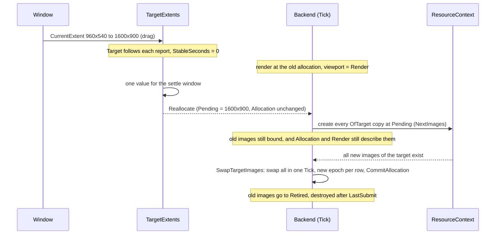
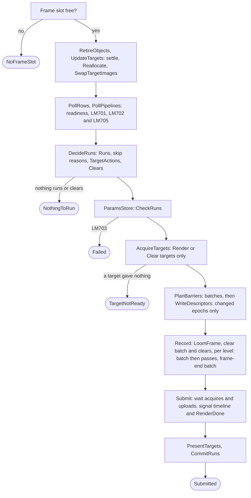
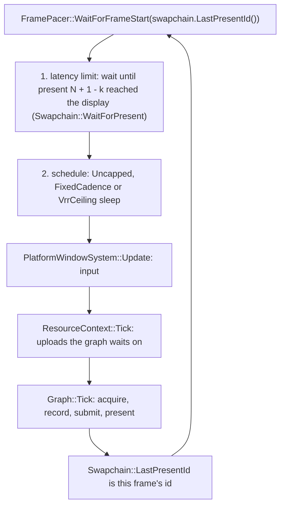

# Loom

Loom is the render graph of DiamondDogs (namespace `loom`, target `loom`). A module declares its resources and
passes through a builder. Compile then turns those declarations into a checked, ordered graph, with no GPU. The
backend's Realize and Tick run that graph on a device (target `loom_vulkan`; step 5 runs buffers and compute
dispatches only).

The design record is the API spec, and the agent handbook holds the working state. Both are in the author's
untracked `docs/` folder. This README is the map of the code.

## Keys

Every name in a graph is a typed key (`LoomKeys.hpp`): `ResourceKey<Buffer | Image | Sampler>`, `PassKey`,
`SequenceKey`, `AnchorKey`, `FrameTargetKey`, `PathListKey`, `PathKey` and `ParamsKey<T>`. A key is a `Module.Name`
string and its hash, and identity is the hash alone (S6): the name is for diagnostics. A key from a literal is
`consteval`, so a bad name fails the build. Records store keys as `KeyRef`, a view of the name and the hash.

A key from a name known only at run time (an authored graph, CC-R5) comes from `FromName(graph, name)` on each key
type. It returns nothing for a name that is not `Module.Name`, so the caller reports the refusal where the name comes
in. `detail::HashArxSv` is `constexpr`, so the same name gets the same hash on both paths, and a literal key finds what
a runtime key declared. The graph keeps a copy of each runtime name, once per name, in `KeyNames` (`src/Records.hpp`): a
deque, which never moves its strings, so a `KeyRef` view stays valid. The builder and each `CompiledGraph` made from it
share that store, and a `Graph` holds its `CompiledGraph`, so a runtime name lives as long as the last of them. A
`CollectingSink` copies the names it keeps, so its diagnostics outlive the graph too.

## The pipeline

```
 GraphBuilder ──Record()──▶ GraphRecord            what the caller wrote, with a source_location per statement
                               │
                         ┌─────▼─────┐
                         │  Freeze   │  LM1xx, LM306   names to indices, values in range, no shader
                         └─────┬─────┘
                          FrozenGraph
                               │            ◀── rhi::ShaderBundle (device-free), device capabilities and limits
                         ┌─────▼─────┐
                         │  Resolve  │  LM2xx          one variant and its entry points per pass
                         └─────┬─────┘
                          ResolvedGraph
                         ┌─────▼─────┐
                         │   Bind    │  LM301-LM305,   each Bind("name", key) to one slot of that variant
                         │           │  LM307
                         └─────┬─────┘
                          BoundGraph ──Accesses──┐
                         ┌─────▼─────┐           │
                         │   Size    │           │     LM401-LM403     sizes, extents, formats, usage
                         └─────┬─────┘           │
                          SizedGraph             │
                         ┌─────▼─────┐           │
                         │   Order   │◀──────────┘     LM5xx    edges, run order, hazards, dead writes
                         └─────┬─────┘
                          OrderedGraph
                         ┌─────▼─────┐   ◀── LayoutLimits (device limits)
                         │  Layout   │  LM601-LM604    group counts, attachments, feedback loops, limits,
                         └─────┬─────┘                  one description per distinct pipeline
                          LaidOutGraph
                               │
                         CompiledGraph                  Compile() chains the six stages; owns copies, no bundle
═══════════════════════════════╪══════════════ loom (no RHI) above, loom_vulkan below ══════════
                         ┌─────▼─────┐   ◀── ResourceContext, rhi::Device, frame slot count
                         │  Realize  │                  creates resources, layouts, shader objects, sets
                         └─────┬─────┘
                             Graph
                         ┌─────▼─────┐   ◀── Set<T>, Supply, Enable
                         │   Tick    │  LM701-LM705     poll ─▶ DecideRuns ─▶ PlanBarriers ─▶ record ─▶ submit
                         └───────────┘                  (DecideRuns and PlanBarriers are core: FramePlan)
```

Each stage is a free function with a typed input and output, so a unit test can feed one stage directly. Each stage
reports every error it finds to a `DiagnosticSink`, not only the first one, and returns no output when it reported
an error. After Bind, no stage reads a binding name, and Tick touches no Lodestone type.

**File layout (2026-11-20).** Each source file has a header of the same name beside it, and that header declares
what the source defines: `order/Sort.cpp` and `order/Sort.hpp`, `layout/Feedback.cpp` and `layout/Feedback.hpp`. A
stage's output type has its own header, apart from the stage function: `SizedGraph.hpp` holds the table, and
`Size.hpp` declares `Size()`, which `Size.cpp` defines (likewise `LaidOutGraph.hpp` and `Layout.hpp`). A
`*Context.hpp` holds only a stage's shared state, the context struct that its steps pass along, and has no source.
Public headers follow the same rule: `Compile.hpp` and `Compile.cpp`, `CompiledGraph.hpp` and `CompiledGraph.cpp`,
`DecideRuns.hpp` and `DecideRuns.cpp`. The headers forward-declare what they take by reference. Freeze follows the
rule too: `FreezeContext.hpp` holds its state, `Reports.hpp` its LM101 and LM109 helpers, and `Publish`, `ResolveKey`,
`ResolveNames`, `ResolveDraw` and `Validate` are header and source pairs. Only templates and `constexpr` functions keep
their bodies in a header. Source files include what they use directly (clang-tidy `misc-include-cleaner`, 0 findings
on 2026-11-20); headers include only what their declarations need.

## The stages

| Stage | Entry point | Output | Code |
|---|---|---|---|
| Freeze | `Freeze(record, sink)` | `FrozenGraph`: every key resolved to a table index, passes in declaration order. | `src/freeze/` |
| Resolve | `Resolve(frozen, inputs, sink)` | `ResolvedGraph`: per pass, the environment, the variant key and the entry points. | `src/resolve/` |
| Bind | `Bind(frozen, resolved, sink)` | `BoundGraph`: the slot table and the access table. | `src/bind/` |
| Size | `Size(frozen, bound, sink)` | `SizedGraph`: per resource, the buffer byte size, the image extent and dimension, and the GPU usage. | `src/size/` |
| Order | `Order(frozen, accesses, sink)` | `OrderedGraph`: the run order and the reason for each edge. `Explain` prints it. | `src/order/` |
| Layout | `Layout(frozen, resolved, bound, sized, limits, sink)` | `LaidOutGraph`: per pass, the group count and a pipeline index; the table of distinct pipeline descriptions. | `src/layout/` |

Layout reads no `OrderedGraph`: it checks each pass alone, so Order and Layout can run in either order.

`Compile(builder, inputs, sink)` (`include/Compile.hpp`, `src/compile/`) runs the six stages in turn and stops after
the first stage that reported an error. When the graph has path lists, `ChoosePaths` runs first (see "Path lists"). It returns a `CompiledGraph`, described in "Compile output" below.

### Freeze

Freeze needs no shader and no device. It publishes every declaration into one symbol table, then resolves each name
that a statement uses. It also runs the checks that need only the declarations:

- **LM101 to LM113:** a required field is missing, a key has two publishers or none, a value is out of range, a pass
  has no shader or two, or a statement that may appear once appears twice.
- **LM113 and LM306 on binds** (`CheckPassBinds` in `Validate.hpp`): a binding name bound twice in a pass, `Params`
  twice, and `BindPrevious` on a resource with no history ring. LM306 keeps its Bind number, but it needs no shader.

`Import(BufferImportDeclaration)` declares a buffer that the app supplies at run time (`Graph::Supply`). It becomes a
resource row of kind `Buffer`, origin `Imported`, that points into `FrozenGraph::BufferImports`. Its `ByteSize` is
required: a missing or non-positive size is LM109.

### Resolve

Resolve opens one module per pass from the device-free `rhi::ShaderBundle` and selects one variant:

1. `Shaders.cpp`: the module and the entry points exist (LM201), and their stages fit the pass kind (LM202).
2. `Pins.cpp`: the pass pins and the graph pins merge, pass value first, one value per axis.
3. `Variants.cpp`: one query from the merged pins, the device filter, then rounds of defaults until one variant
   remains (LM203 to LM205, LM207). LM206 runs last, on a clean graph only.

Pin modes decide gated axes. A pass pin is `Required`, so it can switch a gate on. A graph pin and a declared
default are `WhenActive`: they test a value only where the axis is active, so they never switch a gate on.

`Supports` must answer from the capabilities that the device has *enabled*, not from what the physical device
supports.

### Bind

Bind reads the layout of the variant that Resolve selected:

1. `Layout.cpp`: `MergedLayoutView::Merge` gives the pipeline layout, each resource once with the stages that read
   it. A dispatch merges its one compute stage, so a dispatch and a draw take the same path. Two stages that disagree
   at one placement are LM304.
2. `Slots.cpp`: each bind name maps to one binding.
   - A name in no variant of the entry points is LM301, with the nearest name. That search walks every variant, and
     it runs only on a miss.
   - A name that only other variants have is skipped with no diagnostic. One build lambda then serves every variant.
   - A key of the wrong kind is LM304. A narrowing that adds access is LM303: a narrowing may only remove access.
   - A binding of the selected variant that no bind names is LM302, except one: a uniform block named `g_LoomFrame`.
     Loom binds it itself (`BindingSlot::BuiltIn == LoomFrame`, with no resource row) to its own per-frame-slot
     buffer, which holds `LoomFrameConstants` (`include/LoomFrame.hpp`): the time, dT, the frame index, and each frame
     target's target, allocation and render extents. A shader declares it with `import LoomFrame;`
     (`shaders/LoomFrame.slang`; its cook adds `LOOM_SHADER_DIR` to `INCLUDE_DIRS`). So a pass keeps its one `Params`
     key and still reads the frame's facts. `loom_tests` checks the C++ mirror against the cooked Slang layout.
   - A view and its root bound to different keys in one pass is LM307 (see "Views and aliases" below). The check
     sees one pass only: a pass that binds the view without its root has nothing to compare with.
3. `Params.cpp`: the `Params` statement against the entry point constants. LM305 is a size check, `sizeof(T)`
   against `Constants().ByteSize()`. The generated `Params<CookProfile>` already asserts each offset, so the size
   catches a type of the wrong profile. Constants that hold caller data and no `Params` statement are LM302.

`BoundGraph` holds:

- `Slots`: one `BindingSlot` per resource, all passes in one array. A pass's slots are
  `Slots[FirstSlot, FirstSlot + SlotCount)`. A slot has the placement form: `Bound` is a descriptor at (group,
  binding); `Handle` and `Pointer` are 8-byte values that Loom writes at `ValueOffset` in a uniform buffer or the
  push constants.
- `Sources`: compile time only, beside `Slots`: the Lodestone reflection of each slot, and its pass and bind. Size
  reads it.
- `Accesses`: Order's input, one access per `FrozenPass::Binds` entry, after narrowing. A bind that the selected
  variant does not use gets `Invalid`, and Order skips it.

### Size

Size gives each declared buffer its byte size and its GPU usage (`src/size/Size.cpp`), and each image its extent,
dimension and GPU usage (`src/size/ImageSize.cpp`). Samplers need nothing from Size.

#### Buffers

Each binding or statement that names a buffer is a requirement:

- **Exact:** the shader states an element count (`[ls_element_count]`), so it uses exactly count times stride bytes.
- **At least:** a uniform block (its block size), indirect arguments (the offset plus 12 bytes for a dispatch; for a
  draw, the offset plus 16 bytes per draw, or 20 when it is indexed, times `MaxDraws` for `DrawIndirectCount`), or a
  draw count (its offset plus 4 bytes).

Sizes compare in **bytes**, never in elements, so two typed views of one buffer agree. A `Bytes(n)` buffer must fit
every requirement. A `Derived` buffer takes its size from the first exact requirement, or from the largest one when
none is exact; a requirement that does not fit is LM401, and no requirement at all is LM402. `DescribeCreation`
decides whether the shader gives a size. An imported buffer gets no size here: its declaration states `ByteSize`,
and its future brings the object. Tick checks the supplied object against it (LM701): it must be a buffer, and
`Description().ByteSize` (which RhiResources reports) must be at least `ByteSize`.

Usage is the union of `RequiredBufferUsage()` over the shader bindings, plus the pass statements: indirect arguments,
vertex and index buffers, and a Record pass's uses. CPU access (maps, upload copies) belongs to Realize.

#### Images

- **Extent.** A binding states an extent with `[ls_extent_1d/2d/3d]`; the axes that it leaves out are 1. The rules
  mirror buffers. A `Fixed` image, or an import with an `Exact` expectation, must equal every stated extent (LM401).
  A `Derived` image takes the first stated extent, and every other one must equal it (LM401); none is LM402. An
  `OfTarget` image and an `AnyExtent` import get no extent here: Realize knows it and checks it (LM701). LM401 reports
  the first axis that differs, so each side is one number.
- **Layers.** On an array texture, the third value of `[ls_extent_3d]` is the layer count, not a depth (Lodestone
  C31), so the stated extent of an array has depth 1. `ImageDeclaration::Layers` is a `LayerSource`, with the same
  rules as the extent: `LayerSource::Fixed(n)` must equal every stated count (LM401, field `Layers`), and
  `LayerSource::Derived()` takes the first stated count, and every other one must equal it (LM401); none is LM402,
  with `Layers` as its expected field. An import's count is its expectation's `Layers`, and Size checks the stated
  counts against it. Only an array shape states a count. Realize creates the image with Size's count
  (`SizedResource::Layers`).
- **Format (LM403).** A storage binding reads and writes raw texels, so its format must equal the image's. A sampled
  binding must read the scalar class of the format: a float binding reads float and depth formats, a depth binding
  depth formats, a uint binding uint formats. Filterability and component count are not checked. A color target needs
  a color format and a depth target a depth format, in a draw or a Record pass.
- **Dimension.** Realize needs 1D, 2D or 3D, and the declaration does not state it. Size takes it from the binding
  shapes (an array or a cube is 2D with layers), and two bindings that disagree are LM403. An image that no shader
  binds is 2D.
- **Usage.** `Sampled`, `Storage` or `RenderAttachment` from each binding kind, plus targets and Record uses. A copy
  for an upload belongs to Realize.

In every LM403, `Expected` is the image's side (its format or first dimension), and `Actual` is the use's side.

### Order

Order builds the edges (anchors, sequences, single-writer data flow), sorts with Kahn's algorithm and a
declaration-order tie-break, and checks the data: LM501 (cycle), LM502 (a hazard with no ordering path), LM503 (a
read before any write), LM504 (dead write), LM505 (orphan pass) and LM506 (a frame-start read with no contents at
frame start). `Explain` and `ExplainPass` print the order and
the reason for each edge.

- **Levels.** Each pass gets a Kahn level: the longest path to it, counted in passes. An anchor orders passes but
  adds no level of its own. `OrderedGraph::Levels[pass]` and `LevelCount` hold them.
- **Run order is level-major:** level 0 first, then level 1, and so on, with declaration order inside a level. In a
  graph where pass 0 writes Data, pass 1 reads it, and pass 2 touches nothing, Kahn's heap alone gives 0, 1, 2; the
  run order is 0, 2, 1. LM502 proves that two passes in one level have no hazard, so the runtime needs a barrier only
  at a level boundary (see "Barriers" below).
- **Persistence (LM503).** A writer whose run policy is not `EveryFrame` keeps its contents across frames, so it is a
  source for reads that come before it in the frame. An imported buffer has its contents at frame start, so a read
  of it needs no writer. This rule only stops LM503. It adds no edge and removes none: a plain `Bind` read of a
  resource with one writer always gets the DataFlow edge writer -> reader, and reads this frame's write.
- **Three times a bind can read.** A plain `Bind` reads this frame's contents: after the writers, by the DataFlow
  edge. `BindPrevious` reads last frame's copy of a history ring: no edge, separate memory. `BindFrameStart` reads the
  contents the resource has when the frame starts, before any writer of this frame: Order adds a `FrameStart` edge
  from the reader to every writer of the slot. It is the read of an in-place update, where a step reads the state and
  a later pass writes the next state into the same resource:

  ```cpp
  // Step: read the state, then write the next state in place. A plain Bind on Advect would be LM501: the sequence
  // puts Advect first, and the data flow puts the writer first.
  graph.AddSequence(k_Step, [](loom::SequenceBuilder& step)
  {
      step.AddDispatch(k_Advect, k_EveryFrame, k_Graphics, [](loom::DispatchBuilder& pass)
      {
          pass.BindFrameStart("StateIn", k_State);                  // the state as the frame found it
          pass.Bind("Velocity", k_Velocity, loom::AccessModifier::WriteOnly);
      });
      step.AddDispatch(k_Commit, k_EveryFrame, k_Graphics, [](loom::DispatchBuilder& pass)
      {
          pass.Bind("Velocity", k_Velocity, loom::AccessModifier::ReadOnly);
          pass.Bind("State", k_State, loom::AccessModifier::WriteOnly);  // next frame's frame-start contents
      });
  });
  ```

  A frame-start read needs contents at frame start (LM506): the resource is an import, an upload, or has a writer
  whose run policy is not `EveryFrame`, and it is not a `Frame` lifetime resource (aliasing may reuse that memory).
  The narrowing of `BindFrameStart` is `ReadOnly`, as for `BindPrevious`. One resource is one copy, so the barriers
  are the plain write-after-read ones. The last write of the frame feeds next frame's frame-start readers, so it is
  not LM504. Choose `BindFrameStart` when the reader and writer share one memory; choose a history ring and
  `BindPrevious` when the writer must not overwrite what the reader still uses (async compute, or a pass that reads
  and writes the same texels).

### Layout

Layout is the last Compile stage. It gives Realize the facts that it needs to create pipelines and record dispatches,
so that Realize makes no decision of its own. Each check lives in the file named for its question (`src/layout/`).

- **Group counts** (`Dispatch.cpp`). A dispatch states threads, and the device runs groups. Each axis is the thread
  count divided by the reflected workgroup size, rounded up: 65 threads in groups of 8 is 9 groups, and the shader
  tests its bounds. `DispatchThreadsOver(image)` divides the image's extent from Size. An image sized from a frame
  target, or an import of any extent, has no extent yet, so the source is `AtRealize` and Layout keeps the workgroup
  size for Realize. An indirect dispatch reads its count from its buffer. A count above `maxComputeWorkGroupCount` is
  LM601.
- **Attachments, LM602** (`Attachments.cpp`). Each output location of the fragment shader needs a `Color` statement
  at that slot, and each `Color` slot needs an output: an attachment with no output receives undefined values. The
  output's scalar class must fit the format (float to a float format, uint to a uint format), and the shader must
  write every component that the format holds. That rule is the opposite of the one for sampled bindings: Vulkan
  fills the components that a sampled read lacks, but not the components that a fragment shader leaves out. A shader
  that writes depth needs a `Depth` statement. A frame target's format is known at Realize, which checks it there.
  `Expected` is the attachment's side, `Actual` the shader's side.
- **Vertex inputs, LM603** (`Attachments.cpp`). Loom has no vertex format statement, so each reflected vertex input
  is LM603, with the semantic in `Binding`. Draws read their vertices from a buffer with `SV_VertexID` (vertex
  pulling), as every ocean draw does. A vertex format statement waits for a real consumer; WebGPU may need one.
- **Feedback loops, LM604** (`Feedback.cpp`). A pass that reads an image that it also writes as a target reads
  undefined texels, because Loom records barriers between passes, never inside one. A depth target with depth writes
  off is read-only, so the pass may sample it (soft particles). An input attachment reads the target through the
  attachment, which is its purpose. A Record pass states both sides as uses.
- **Device limits, LM601** (`Limits.cpp`). Resolve already checks the workgroup size, invocations, workgroup memory
  and push constant bytes (LM207). Layout checks the rest that Compile can see: descriptor sets (highest group + 1),
  descriptors per stage (a combined image sampler counts as a sampler and a sampled image; `maxPerStageResources`
  counts the color attachments and not the samplers), color attachments (highest slot + 1), buffer ranges (Bind has
  no range, so a descriptor covers the whole buffer), and image extents per dimension. Only `Bound` slots are
  descriptors, and an unbounded array is not counted: bindless has its own limits. `LayoutLimits` holds the limits
  in `VkPhysicalDeviceLimits` terms, so Compile stays device-free; fill every field, because 0 rejects. `Expected` is
  the limit and `Actual` the value, both under the limit's name.
- **Pipelines.** Each dispatch and draw gets a `PipelineDescription`: module, variant suffix, entry points, color
  formats and blend per slot, depth format, compare and write, and raster state. Identity is by name (G9), never by
  `VariantKey`. Equal descriptions (`==`) share one row. There is no hash: the cache across recompiles belongs to
  Realize, and the pipeline shape itself waits for a design that suits Vulkan and WebGPU both.

## Path lists

A path list holds alternative bodies for one part of the graph, one per device tier. Compile chooses one path per
list, once per device. The other paths make no resources and no pipelines, and load no shaders.

```cpp
const auto depthPaths = [&](loom::PathListBuilder& list)
{
    list.Produces(k_Depth);                   // the contract with the rest of the graph
    list.Path(k_CountPath, countPath);        // in order of preference
    list.Path(k_SinglePath, singlePath);      // the last path is the fallback
};

graph.AddPaths(k_DepthList, depthPaths);
```

A path body gets a `PathBuilder`: the sequence calls (`AddDispatch`, `AddDraw`, `AddRecord`, `After`, `Before`,
`ExposeAnchor`), plus `Declare` and `Import` for resources that only this path has.

**The contract is the outputs.** The list states the keys that it produces. Each path must write each produced key
(LM308), and a path must not write a key from outside the list that the list does not produce (LM309). A path's inputs
are its own: a ray-traced path and a raster path can read different data. Declare or import those inputs in the path.
Two paths can use the same key for a path-local resource, because only the chosen path declares it. Every path must
expose the same anchors (LM116). The order between a produced key and its readers is the normal data flow (LM502).

**The choice** (`src/compile/ChoosePaths.cpp`, the first step of `Compile`):

1. A forced path (`CompileInputs::ForcedPaths`) wins. A forced entry that names no list or no path is LM103.
2. Else each list takes the first path whose statements the device satisfies. A statement implies a neutral
   capability (`bootstrap::DeviceCapability`): a `DrawIndirectCount` draw needs `DrawIndirectCount`.
   `CompileInputs::Capabilities` is the sorted list that the device was created with (`DeviceFilter::Capabilities`).
3. Then a trial Freeze and Resolve run into a scratch sink. When a pass of a chosen path gets LM207 (no variant that
   the device can run), its list moves to its next path. This repeats until no path pass gets LM207. So "the device
   can run this path's shaders" is exactly Resolve's rule.
4. A list with no path left is LM115: one diagnostic per path, with the first capability that it lacks. A list with no
   paths is LM114.

The output is a copy of the record. Each list becomes an ordinary sequence under the list's key, with the list's
`After` and `Before` added, and the chosen path's declarations join the graph's. Freeze to Layout do not know about
lists. LM308 and LM309 run after Bind, because Bind knows every access. A graph with no list compiles the builder's
record directly, with no copy.

**After Compile.** `CompiledGraph::ChosenPath(list)` and `IsChosen(list, path)` name the choice, so the app supplies
the chosen path's imports. `ExplainPaths(compiled)` prints each list's choice and why each earlier path was passed
over:

```
LoomDraw.DepthList: chose LoomDraw.SinglePath
  passed over LoomDraw.CountPath: pass 'LoomDraw.Prepass' needs DrawIndirectCount
```

**Device needs.** `GatherDeviceNeeds(builder, bundle_file)` (`include/GraphDeviceNeeds.hpp`) gives bootstrap's
`GatherDeviceRequirements` the graph's needs before the device exists. A capability of a pass outside every list, or
of the last path, is Required: the fallback must run. A capability of a higher path is Wanted. `WantedOnly` lists the
entry points that only higher paths use, so bootstrap makes their shader capabilities Wanted too. The result views into
the builder, so use it before the builder changes.

**Testing every path.** Compile each path with `ForcedPaths`. The forced compiles run LM308 and LM309 on each path, so a
tier that drops an output fails a test. GPU tests run the device's choice, then each lower path forced.

## Compile output

`CompiledGraph` (`include/CompiledGraph.hpp`) is opaque to the app: it gives the pass and resource counts and the
index of a key. Backends read `Data()`, a `CompiledData` (`src/compile/CompiledData.hpp`). Every table in it owns its
data, with no view into the bundle (G4), so the bundle can close when Compile returns. Keep it open while the sink
still holds Compile's diagnostics, because their binding names are views into it.

`CompiledData` holds each stage's output, plus the tables that a backend needs and no stage made:

- `Pipelines` (`compile/Pipelines.cpp`): per distinct pipeline, a copy of each stage's code and entry point, the
  workgroup, the push constant range, and the pass whose slots give its descriptor layout.
- **Rows.** The resource rows (`FrozenGraph::Resources`), then one row per imported frame target
  (`CompiledFrameTarget::Row`; `IsFrameTargetRow`, `KeyOfRow`). `RowCount` (`CompiledGraph::RowCount()`) sizes every
  per-row span: a backend's `ResourceState`s, `SkippedWriter`, the copy tables. A frame target's `Fallback` comes from
  its `Output` declaration; with none it is `KeepLast`.
- `Uses` (`compile/Uses.cpp`): per pass, one entry per row it touches, merged over its slots and statements: the
  access, the `SyncScope` (stages and accesses), the image layout the use needs, `Initializes` (a write with no read,
  for Q3g), `Previous` (a `BindPrevious` read, which reads last frame's copy: a separate use from a write of the
  same row in that pass), and `FrameStart` (every read of the use is a `BindFrameStart`; one copy, so it merges with
  a write of the same row). Storage images use `General` and sampled reads `ShaderReadOnly`. Every use of one image in
  one level must see one layout, because one barrier batch goes before the level, so uses that disagree all take
  `General`. `SlotLayouts` gives each descriptor its use's layout. Besides the shader slots: indirect arguments and a
  draw count (`DrawIndirect` stage, indirect-command read), index and vertex buffers, attachments, and a Record pass's
  `Uses` statements (one table maps each `ImageUse` and `BufferUse` to its scope and layout; a shader use names the
  vertex, fragment and compute stages, because Loom cannot see which one the callback uses).
- `Attachments` (step 7 Q3): per Draw pass, and per Record pass with target uses, one `CompiledAttachment` per target:
  its `AttachmentRole` (`Color`, `Depth`; later `Stencil`, `Resolve`, `ShadingRate`), row, color slot, load, store and
  clear value. One table (`AttachmentShape`) gives each role its scope and layout: a color target is
  `ColorAttachmentOutput` in `ColorAttachment` (with the read bit when it keeps or blends); a depth target is the
  fragment tests, in `DepthAttachment` when the pass writes it (a depth write or a load Clear) and in `DepthReadOnly`
  when it only tests. A Record pass's targets store Store, and load Keep for a `Read` or `ReadWrite` use and DontCare for `Write` (Keep reads the target, and a `Write` barrier grants no read): Loom begins rendering around its callback.
  Each backend maps the roles to its API in one switch.
- History copies: a row with `HistoryDepth` D has D + 1 copies (spec R3). Copy `row` is each row's first copy, so a
  row with no history is its own copy; a ring's other copies follow the rows (`ExtraCopyBase`, `CopyRows`).
  `CopyOf(data, row, frame, previous)` gives the copy that frame `frame` writes, or reads through `BindPrevious`.
- `Params`: per `Params` statement, the key and the size and alignment of its type.
- The first and last level that uses each row (`Spans`), and the alias candidates (`AliasCandidates`, "Aliasing").

## The core runtime

The core (`loom`, `src/runtime/`) decides what runs and where the barriers go. It links no RHI:
`bootstrap_assert_no_rhi` fails the configure if `loom` or `loom_tests` reaches `rhi_system`. Every type in
`include/FramePlan.hpp` is plain data, so `loom_tests` checks every decision with no GPU, and a WebGPU backend can
read the same plan.

The backend gives the core one `ResourceState` per resource row each Tick: a `ResourceReadiness` (`Pending`,
`Created`, `Complete`, `Failed`) and an epoch. The epoch counts the objects that the row has had: a `Supply` of a new
future, or the graph's own create, adds one. The core then fills a `FramePlan`. `PrepareFramePlan` sizes its arrays
once, at Realize, so a Tick allocates nothing.

### Which passes run (`DecideRuns`)

Each pass, in run order:

1. **Enabled:** `Graph::Enable(pass, false)` skips it (`Disabled`).
2. **Run policy** (`Policy` when it says no):
   - `Once` runs until it has run and been submitted.
   - `WhenInputsChange` runs on its first Tick, then only after a change: (a) a row it reads got a new object
     (`Supply`, through `MarkRowChanged`), (b) a params key it reads got new bytes (`Set` compares the bytes, so an app
     that sets the same values every frame does not rerun it; `MarkParamsChanged`), or (c) a pass earlier in this
     Tick wrote a row it reads. A change that it could not run for (a pending row, say) is kept for the next Tick.
   - `OnTrigger` runs after `Graph::Trigger(pass)`. The trigger waits until the pass can run, and several triggers
     before one run count as one.
   `CommitRuns` updates these flags after the submit. A `BindPrevious` or `BindFrameStart` read is not an input change
   of this Tick: the row written this Tick is next Tick's change.
3. **Readiness:** first the pass's pipeline. The backend gives one `PipelineReadiness` per pipeline each Tick,
   because it makes pipelines in the background (the Vulkan compile thread, WebGPU's `CreateComputePipelineAsync`): a
   `Failed` pipeline stops the pass for good (`PipelineFailed`, LM705), and a `Pending` one stops it this Tick
   (`PipelinePending`), with the pipeline as `Cause`. Then the rows: a `Failed` row stops the pass for good
   (`Failed`). A `Pending` row stops it this Tick (`NotCreated`). `Created` is enough to run: the submit waits for the
   transfer.
4. **History:** a `BindPrevious` read of a copy with no contents yet (`ResourceSync::HasContents`): `OnNoHistory::Skip`
   skips the pass (`NoHistory`, with the row as `Cause`); `OnNoHistory::Clear` runs it, and puts the copy in
   `FramePlan::Clears`.
5. **Propagation (Q3g):** if an initializing writer of a row skipped earlier in this Tick, a pass that reads the row
   skips too (`Propagated`, with the writer as `Cause`). A `Policy` skip does not propagate: the pass left valid
   contents behind. A `BindPrevious` or `BindFrameStart` read does not propagate either: it reads what was there
   before this Tick's writers.

`FramePlan::Decisions[pass]` holds each reason and its cause, and `Runs` holds the passes that run.

Then each frame target gets a `TargetAction` (step 7): `Render` when a pass that runs writes it; otherwise its
fallback decides. `OutputFallback::Clear` gives `Clear`, and the target row joins `FramePlan::Clears` (the backend
clears it to the fallback color). `KeepLast` gives `Skip`: the backend does not acquire the target and does not
present it, so the compositor or the canvas keeps showing the last frame, and no copy of each frame is kept.
`ExplainLastTick(compiled, plan)` (and `Graph::ExplainLastTick()`) prints the decisions, one line per pass, then one
line per frame target.

### Barriers (`PlanBarriers`)

`ResourceSync` carries, per copy (a history ring has several), from Tick to Tick: the last write's scope, the read
scopes that a barrier already made it visible to, the reads since the last write, an image's layout, and whether the
copy has contents. A new epoch starts a copy again, in the `InitialLayout` that the backend gives: `Undefined` for a
graph image, the layout of the usage stated at `Supply` for an import. Against that state, per copy:

- a read after a write needs a barrier from the write to the read, unless an earlier barrier already made the write
  visible to that read scope;
- a write after a write needs a barrier from the old write to the new one;
- a write after reads needs a barrier from the reads to the write (an execution dependency only);
- an image use whose layout differs from the image's needs a layout change. It waits for the last write and every
  read since, makes the write visible to the use, and replaces the three rules above for that use. After it, the copy
  counts as written in the stages after the change, so a later barrier chains through it.

`OnNoHistory::Clear` adds a batch before every run (`BeforeRun == k_BeforeClears`): each cleared copy waits for its
earlier accesses and goes to a transfer write (an image to `General`). The backend then clears it, and the first
level's reads wait for the clear by the rules above. A frame target with the `Clear` action joins the same batch, but
as a color-attachment write in `ColorAttachment`: the backend clears it with an empty rendering pass (load op Clear),
because a swapchain image has color-attachment usage only, and `vkCmdClearColorImage` needs transfer usage.

A frame-target row starts a new epoch at each acquire, in `Undefined`, so its first use this frame changes its layout
from `Undefined`. After the last level, the frame-end batch (`BeforeRun == k_AfterRuns`) moves each acquired target
to the `ResourceState::FinalLayout` that the backend states for it (`PresentSource` for a swapchain), after every
access of the frame. A target with no final layout (an offscreen target that keeps its last use's layout) has no
frame-end barrier.

Scopes are in the RHI's barrier vocabulary, `rhi::PipelineStage` and `rhi::Access` (`rhi_types`, which links no
RHI), so the core and every backend share one set of values and no mapping step exists. Storage and sampled reads use
the narrow synchronization2 bits (`ShaderStorageRead`, `ShaderStorageWrite`, `ShaderSampledRead`), so a barrier to one
kind of read does not count as visibility to another. Task and mesh stages come from the slot's shader stages.

All barriers before one level go into one `BarrierBatch`, with one planned barrier per row (a second need on the row
widens the first). Because the state carries over from the last Tick, the first batch is the frame-start batch: it orders
this frame's first accesses after earlier frames' work on the same queue. A row whose epoch changed starts with no
pending work, because a new object owes nothing to the old one. Split barriers come later, from measured timestamps.

### Target extents (`TargetExtents`)

`include/TargetExtents.hpp` holds the three extents of a frame target (step 7, round 2 Q1), as a pure function that a
backend calls once per acquire:

- **Target:** what the target reports (the swapchain extent; a web canvas's CSS size times `devicePixelRatio`).
- **Allocation:** the extent of the `OfTarget` images in use (times each image's own scale, `ScaledExtent`). It
  lags the target. When the target has kept one value for the settle window (counted with Tick's `dT`, so no clock
  call), or says its resize finished, that value becomes **Pending**, and `UpdateTargetExtents` returns `Reallocate`.
  The backend makes the new images at Pending, and `CommitAllocation` moves Pending to Allocation on the Tick that
  swaps them in. A failed create calls `DropPendingAllocation`: the old allocation stays, and the settle window starts
  again. The first report allocates at once. An empty extent (a minimized window) never becomes the allocation.
- **Render:** `min(target x render scale, allocation)`. Viewports and scissors use it. `SetRenderScale` (0 < scale
  <= 1) is the hook for the scalability system: it changes only the render extent.

During a drag the scene renders at the old allocation, and the pass that writes the frame target scales it up with
`LoomFrame`'s `RenderToAllocation`. `UpdateTargetExtents` returns `Reallocate` once, when the resize settles; the
backend then creates the new images in the background and swaps them in one Tick (step 7b).

So Allocation, Render, `g_LoomFrame` and the images in use always agree: during the creation of the new images, all
of them still describe the old ones. (Until 2026-11-23 the allocation moved at `Reallocate`, and the render area was
larger than the images in use until the swap.)



### Params (`ParamsStore`)

"Params" is Loom's name for the uniform parameters of one entry point, which Slang treats on their own; Loom writes
them as push constants. `Graph::Set<T>(key, value)` copies the bytes into one slot per key, sized at Realize. A type
whose size or alignment differs from the `Params` statement's type is LM704. A running pass whose key was never set
is LM703, and that Tick fails before it records anything.

## The Vulkan backend (`loom_vulkan`)

`vulkan/include/LoomGraph.hpp` is the face: `RealizeInputs`, `Graph`, `ShaderLimitsOf` and `LayoutLimitsOf` (they
fill `CompileInputs` from a device). `loom_vulkan` links `loom`, `rhi_system` and `rhi_resources`. The core links
`rhi_types` and `rhi_resource_types` only, the plain-type targets, and `bootstrap_assert_no_rhi(loom)` proves it.

### Realize

`Graph::Realize(compiled, inputs)` first checks that it can run the graph, and refuses with a `RealizeError` if not.
The "NotYet" values name what is missing: cube images, formats with no `ImageFormat` and more frame targets than
`LoomFrame` holds (`ResourceKindNotYet`), the `Handle` and `Pointer` placements (T2), and binding kinds other than
uniform and storage buffers, sampled and storage textures, and samplers (arrays, texel buffers, combined
texture-samplers, input targets) or a bound vertex buffer (vertices are pulled). Step 7 adds three checks:
`FrameTargetUnbound` (an imported `FrameTargetKey` with no entry in `RealizeInputs::FrameTargets`), `SettleUnset`
(`TargetSettleSeconds` < 0; it has no default) and `DrawStateUnavailable` (a draw, and the device lacks the
`VK_EXT_extended_dynamic_state3` entry points). It then:

- creates each graph-declared buffer, image (with one view, arrayed when a binding reads it as an array or it has
  layers; a depth format's view sees its depth aspect) and sampler through `ResourceContext`, and keeps the future,
  so a graph resource and an import have one readiness path. A history ring's other copies are created the same way,
  named `<key>#<n>`. Usage comes from the uses (UBO, SRV or UAV per stage; render-target and depth read and write;
  index, vertex and indirect; transfer), the CPU access, and transfer-destination for `OnNoHistory::Clear`. An
  `OfTarget` image (and its ring copies) waits: Tick makes it once its frame target first reports an extent;
- binds each frame target to its `FrameTarget` object; its row is always `Created` and states the target's
  `FinalLayout()`. When the graph draws, it loads the dynamic-state entry points (`RasterRecording.cpp`). When a shader
  declares `g_LoomFrame`, it creates the `LoomFrame` uniform buffer;
- builds its own set layouts and pipeline layouts from the slot table, and starts one compile thread (a
  `std::jthread` per graph) that makes the shader objects from the copied SPIR-V (`rhi::ShaderProgram`), with no
  `VkPipeline`. It is an ownership handoff with no lock: Realize fills one job per pipeline and starts the thread;
  from then on only the thread touches the jobs and writes each pipeline's shader objects, and it publishes each one
  with a release store to an atomic `PipelineReadiness`. Tick reads the states (acquire) and reports LM705 for a
  failure, on its own thread, because a sink is not thread-safe. The destructor stops the thread between jobs and
  joins it first. Until a pipeline is made, its passes skip `PipelinePending`; an app that needs whole frames waits
  on `Graph::Ready()`;
- makes the descriptor sets of each pass: one set of groups per (frame slot, ring phase). A pass that binds history
  rings has as many phases as the least common multiple of their copy counts, so each set always meets the same
  copies and is written again only when a row's epoch changes (spec R3). It also makes one command pool per frame
  slot, and a timeline semaphore that it registers with `ResourceContext` as a consumer timeline;
- with `PassTimestamps::On`, makes `rhi::GpuTimers` for per-pass times (`LatestTimings()`).

Realize does not block. `FrameSlots`, `Timestamps` and `TargetSettleSeconds` have no defaults. The `Graph` destructor blocks: it waits for
the last submit, unregisters the timeline, then frees what the graph made.

### Tick

`Graph::Tick` never blocks (T1). Each status other than `Submitted` means "try again next Tick". The flow, with the
status that each early exit returns:



The core (`DecideRuns`, `PlanBarriers`) only writes the `FramePlan`; the backend only reads it. That is why
`loom_tests` can prove every decision and every barrier with no device, and why a WebGPU backend can reuse the plan.
In order:

1. **Frame slot.** If the timeline has not reached the value that this slot last signaled, return `NoFrameSlot`.
   `WaitForFrameSlot(timeout)` blocks for it, outside Tick, on desktop only.
2. **Targets** (`RetireObjects`, `UpdateTargets`, step 7). Retired objects that exist are destroyed after
   `LastSubmit()`. Each frame target's `CurrentExtent()` goes to `UpdateTargetExtents`. When the allocation extent
   changes, every copy of every `OfTarget` image of that target is made again at the new extent: the first time,
   each copy takes its image at once; after that, the new images wait in `NextImages`, the old ones stay in use, and
   when all new images of the target exist they swap in on one Tick (a new epoch for each row, so its barriers,
   descriptors and `WhenInputsChange` readers start again). No frame is skipped.
3. **Poll** (`PollRows`). Map each future to a readiness. A `Created` future whose transfer is not submitted yet is
   `Pending` (Q4): there is nothing a submit could wait on. A history ring is as ready as its least ready copy.
   LM701 (a supplied object breaks its import's promise: a buffer smaller than `ByteSize`; an image whose format or
   layer count differs, or, for `Exact`, whose extent or mip count differs) and LM702 (a future failed) are reported
   once per epoch. A row with LM701 is
   `Failed` until the next `Supply`. `PollPipelines` copies the compile thread's states and reports LM705 once per
   failed pipeline, against the pass whose slots gave its layout, with the driver's result.
4. **Decide** (`DecideRuns`). No pass runs and no target clears: return `NothingToRun`. (At the first Ticks, while the
   `LoomFrame` buffer is still being created, also `NothingToRun`.)
5. **Params** (`ParamsStore::CheckRuns`). LM703: return `Failed`.
6. **Acquire** (`AcquireTargets`, spec 5.1 step 4). Each target whose action is `Render` or `Clear` is acquired with
   `TryAcquire(LastSubmit())`. One that gives nothing returns `TargetNotReady`; nothing is recorded yet, so nothing is
   lost. The targets acquired so far go back (`ReleaseTargets`, `FrameTarget::Release`); a target that cannot give an
   image back without a present (a swapchain without maintenance1) stays acquired for the next Tick. A new acquire
   starts its row's epoch in `Undefined`.
7. **Barriers** (`PlanBarriers`), then **descriptors** (`WriteDescriptors`). A slot's sets are written again only
   where a row changed epoch since the last write; a `g_LoomFrame` slot is written once.
8. **Record and submit** (`SubmitFrame`). One `vkCmdPipelineBarrier2` per batch, with one global memory barrier
   that merges the scopes of the batch's rows (every buffer uses concurrent sharing, so this orders the same work as
   one buffer barrier per row; `ExplainLastTick` still lists the rows), plus one image barrier for each layout change
   (every mip and layer, color aspect). The clear batch and the clears (`vkCmdFillBuffer`, `vkCmdClearColorImage`,
   and an empty rendering pass for a frame target) come first. Then the passes of that level. A `DispatchThreadsOver` an image whose extent Compile did not know (an
   `AnyExtent` import) takes its group count from the image's `Description()`: width, height, and depth or layers. The
   submit waits for each row that a running pass uses and that is `Created`, not `Complete` (CC-R2), with one wait
   per semaphore at the highest value, and for each acquired target's acquire semaphore. It signals the graph's
   timeline, and the render-done semaphore of each acquired target (`AcquiredTarget::RenderDone`; the target owns it).
   - **First:** `LoomFrame` (`vkCmdUpdateBuffer` between two global barriers: last frame's reads finish before the
     write, and the write is visible to this frame's reads).
   - **Draw pass:** shader objects and the draw state (`RecordDrawState`: every piece of state that shader objects
     need, from the pass's `PipelineDescription`) are set only when the pipeline changes. Then the descriptor sets
     (graphics bind point) and params, `BeginRendering` from the pass's attachments (the role switch, with each use's
     layout), a viewport with a negative height (Y-up NDC, as on WebGPU) and a scissor over the render area, the one
     draw command (`RecordDrawCommand`: `vkCmdDraw`, `DrawIndexed`, `DrawIndirect` or `DrawIndirectCount`, indexed
     when the pass has an `IndexBuffer`), and `EndRendering`. The render area is the smallest of the attachments: a
     frame target's acquired extent, an `OfTarget` image's render extent times its scale, or another image's extent.
   - **Record pass:** with target uses, a rendering scope (Keep, Store) and viewport around the callback, which gets
     a `RecordContext` (the command buffer and the objects of its declared keys only). After it, all command buffer
     state counts as unknown: the next pass binds its shaders and state again.
   - **Last:** the frame-end batch (`k_AfterRuns`).
9. **Present** (`PresentTargets`) each acquired target, then **commit** (`CommitRuns`) and return `Submitted`.

**Frame targets.** `include/FrameTarget.hpp` (in `loom_vulkan`) is the interface: `CurrentExtent()`,
`ResizeFinished()`, `TryAcquire(last_submit)`, `Present()`, `Release()` and `FinalLayout()`, none of which blocks, and
`WaitForPresents(timeout)`, which blocks and which only the `Graph` destructor calls. An `AcquiredTarget` carries the
image, its view, and two semaphores that the target owns: the one Loom's submit waits on, and the render-done one it
signals. Loom holds a reference to each target and never owns it. `OffscreenFrameTarget` serves headless runs and
tests (no semaphores). `SwapchainFrameTarget` (`loom_vulkan_platform`, so that `loom_vulkan` links no PlatformSystem)
adapts PlatformSystem's `Swapchain`, which owns acquire, present, release, every semaphore and the present fences
(presentation plan P1; `modules/PlatformSystem/README.md` has the reuse rules). It acquires with a timeout of 0, and
when the swapchain is out of date or suboptimal it recreates it, but only once `last_submit` has passed.

**Present fences.** A present waits on a render-done semaphore after the graph's timeline signals, so the timeline
cannot say when a present finished. With swapchain maintenance1 (`k_SwapchainMaintenance1Feature`, which the window
stage asks for as Wanted), `Swapchain` gives each present a fence, and a recreate needs no idle device: the old
swapchain is destroyed once its presents finished. The `Graph` destructor waits on the fences. Without the feature, a
recreate and the destructor wait for the whole device (`vkDeviceWaitIdle`).

One frame on a swapchain:

```mermaid
sequenceDiagram
    participant T as Tick (CPU)
    participant S as SwapchainFrameTarget
    participant Q as Queue
    participant P as Present engine
    T->>S: TryAcquire(LastSubmit), timeout 0
    S->>P: Swapchain::TryAcquire: vkAcquireNextImageKHR(acquire semaphore a)
    S-->>T: image i, view, extent, wait a, signal RenderDone[i]
    Note over T: row epoch++, layout Undefined
    T->>Q: submit: wait a and upload timelines; clears, levels, frame-end batch
    Note over Q: signals timeline value N and RenderDone[i]
    T->>S: Present()
    S->>P: Swapchain::Present: vkQueuePresentKHR(wait RenderDone[i], present fence f)
    P-->>S: fence f signals: this present finished
```

Why one render-done semaphore per image, and why an acquire semaphore is free again at the next acquire of the same
image: PlatformSystem's README explains both. `Graph::SetRenderScale(target, scale)` is the scalability hook; `Graph::ExtentsOf(target)` gives the three
extents.

For the app: `Timeline()` and `PendingValue()` feed `ResourceContext::Tick`, and `LastSubmit()` is the `GpuWait` that
a transfer must wait on before it reads what the graph wrote. `Supply` on an imported buffer starts a new epoch. The
supplier still owns the buffer, and frees an old one only after `LastSubmit()` passes (CC-R4);
`ResourceContext::DestroyResource(resource, graph.LastSubmit())` does that. `Supply(image, future, usage)` takes the
usage the image is in at handoff, and its first barrier starts from that usage's layout.
`Supply(image, future, usage, wait)` also takes an `rhi::GpuWait` for outside work on another queue that must end
before the graph uses the object, for example a video encoder that still reads the image the graph wrote last frame.
Every submit that uses the row waits on it (`GatherWaits`), whether or not the row's contents are complete; an empty
wait is the same as the form without it. The pattern for an outside reader is a ring of imported images: before each
Tick, `Supply` the next one with the reader's last wait on it, and have the reader wait on `LastSubmit()`. Vulkan only:
WebGPU has one queue. `BufferOf(key)` and
`ImageOf(key)` give a row's object; for a history ring, the copy the last submitted frame wrote.

**Frames in flight.** Each resource has one copy, and the frame-start batch orders frame N+1 after frame N. Copies per
frame slot come with async compute (step 8), chosen per resource from measurements.

### The frame loop

Tick never blocks, so the waiting happens outside it, in the app's loop (presentation plan D4). LoomTriangleTest's loop
is the model; an app's loop has the same order:



The pacer comes first so that input is read as late as possible: with a latency limit of 1, a frame starts only once
the display showed the frame before it, and the input it reads is at most one frame old when it reaches the screen.
`FramePacer` is in foundation and has no graphics API: the app binds the swapchain's wait to it as a
`PresentWaitDelegate` (LoomTriangleTest's `SwapchainPresentWait`). The PlatformSystem README explains the modes and
the present ids.

### What synchronization validation sees

The layer's synchronization validation does not check the descriptor accesses of shader-object dispatches (SDK
1.4.357). It skips a dispatch that has no bound `VkPipeline`, and it ignores shader accesses unless
`syncval_shader_accesses_heuristic` is on. A spike with `VkPipeline` compute and the heuristic on still caught none
of the planted barrier faults, so Loom has no pipeline mode for it (removed 2026-11-21). The barrier rules are proven
in `loom_tests` instead.

Image layouts have the same gap on this machine. With the image barriers removed, or with every descriptor naming
`General`, LoomImageTest still matches the CPU and the layer prints nothing (2026-11-21): the NVIDIA driver ignores
layouts, and the layer does not check a descriptor's layout against the image's for these dispatches. So the layout
plan is proven in `loom_tests`, and the backend's image barriers and descriptor layouts are not proven by any test.
A clear that is not recorded is not caught either, because new memory is zero.

Draw passes are better covered: the layer checks each attachment's layout at `vkCmdBeginRendering`, and the image
accesses of each draw. The step 7 GPU plants (2026-11-23, ninja-msvc, each restored byte for byte) all failed the run:

| Plant | Caught by |
|---|---|
| No wait on the acquire semaphore (`GatherWaits`) | LoomTriangleTest: `SYNC-HAZARD-WRITE-AFTER-PRESENT`, `MissingAcquireWait`, `non-acquired-swapchain-image-used`. LoomDrawTest cannot see it: an offscreen target has no semaphore. |
| No frame-end batch | LoomTriangleTest: `VUID-VkPresentInfoKHR-pImageIndices-01430` (the image is not in `PresentSource`). LoomDrawTest: `VUID-vkCmdDraw-None-09600`. |
| No batch before GBuffer (the prepass to GBuffer depth barrier, and the layout changes in the same batch) | Both: `VUID-vkCmdBeginRendering-pRenderingInfo-09588`, `-09592`, `VUID-vkCmdDraw-None-09600`. This plant also removes the layout changes, so it proves the layout path, not the depth write-to-read dependency on its own. |

## The WebGPU backend (`loom_webgpu`)

`webgpu/include/LoomGraph.hpp` has the same vocabulary as the Vulkan face. It builds only in the Emscripten
configuration (`emdawnwebgpu_cpp`; the `else()` branch of this module's `CMakeLists.txt`), so neither desktop preset
compiles it. It reads the same `CompiledData` and `FramePlan`; it plans no barriers, because Dawn tracks hazards.

- **Compute only today.** Realize refuses Draw and Record passes, frame targets, `LoomFrame` and push-constant
  delivery ("NotYet" values). The parity order is in the agent handbook.
- **Layouts follow the shader.** A bind group layout entry must match the WGSL declaration exactly, so it takes
  `CompiledData::SlotReflectedAccess` (the access before narrowing), not the slot's narrowed access: Slang declares an
  `RWTexture2D` `read_write`, and a `WriteOnly` bind of it still needs a `ReadWrite` layout. A write-only image is
  `WTexture2D`, written with `Store`; WebGPU allows `rgba32float` as `read_write` only with `texture-formats-tier2`.
- **Pipelines are async.** Realize makes the layouts and the shader module, and calls `CreateComputePipelineAsync`.
  Each callback holds a share of one `PipelineResults` block, so a callback after the `Graph` is gone writes into live
  memory: shared ownership, not a lock (the callbacks run on the browser's main thread, between Ticks). Tick moves
  each made pipeline into place and reports LM705, with the browser's message, for a failed one.
- **One compute pass per Tick** holds every dispatch, in run order; Dawn orders the storage accesses between them.
- **Bind groups** are cached per (pass, ring phase) and built again only when a row's epoch changes (spec R3).
- **Params** go to one uniform buffer, one 256-byte-aligned slice per pass, with `queue.WriteBuffer`. A write is
  copied at the call and runs before the next submit, so a fixed slice is safe with frames in flight.

The web tests are `WebGpuLoomComputeTest` (the compute test's two variants and LM701) and `WebGpuLoomImageTest`
(LoomImageTest's seven passes). Build them with `cmake --preset emscripten` and the Debug config, serve
`build/emscripten/tests/integration_tests` on 127.0.0.1 (`python -m http.server`), and open the `.html` in a browser
with WebGPU. A pass is `window.__ddTestPassed` true and a console with no `[webgpu] uncaptured device error`; the
device stage prints every uncaptured error. Each test waits on `Graph::Ready()` before it ticks, so its frames are whole.

## Formats

Image declarations use Lodestone's `TextureFormat` (`include/LoomFormats.hpp`), because reflection reports a storage
image's format in it. `ToTextureFormat` converts foundation's `ImageFormat`: for content the compiler imports, and
for a format the app picks at run time from what the device supports. It gives no value for a format that Lodestone
lacks (16-bit unorm, signed integer, three-component), and each of those is a request to Lodestone. The enum is
declared opaque in the header, so it stays light; code that names an enumerator includes Lodestone's
`ResourceFlags.hpp`. RhiResources' flags are in `RhiResourceFlags.hpp` (renamed 2026-11-19 to end a name clash).

## Views and aliases

Two words, two opposite ideas. Keep them apart in code, comments and diagnostics.

- **A view** is one resource seen through more than one binding, all valid at the same time. PlanetGen binds one
  buffer as atomic `uint`s in some entry points and as plain `int4`s where it only reads. The shader marks the second
  binding as a view of the first (`ViewOf:<root>` today, Lodestone request C27 later). Order treats every binding of
  one key as one resource, so views need nothing from Order. Size compares them in bytes; Bind checks that a view and
  its root name one key (LM307).
- **An alias** is more than one resource sharing one memory, never valid at the same time. "Aliasing" below has the
  details.

## Aliasing

Rows that are never live in the same level share memory. It is Vulkan only (`rhi::placement`); WebGPU has no
placement, and its backend gives every row its own memory.

- **Candidates** (`alias/Lifetimes.cpp`, at Compile, no device): a declared buffer or image with
  `ResourceLifetime::Frame`, no history, `CpuAccess::None`, at least one use, and no writer whose run policy is not
  `EveryFrame` (such a write persists across frames, by the LM503 rule). An image sized from a frame target is not
  one: a resize makes it again, and the heaps do not move. Each candidate keeps its span: the first and last level
  that uses it. `CompiledData::AliasCandidates` holds them.
- **Why levels, not run positions.** The passes of one level run with no barrier between them, so they can run at the
  same time. Two rows used in one level can never share bytes, even when their passes look sequential in run order.
- **Packing** (`alias/Packing.cpp`, no device, so `loom_tests` checks it with needs written by hand). Realize asks the
  device what each candidate needs (`rhi::placement::Get*MemoryRequirements`, with the create info its row is made
  from). Candidates group by class (buffers and images never share a heap: no `bufferImageGranularity` padding) and
  memory type mask. Each group packs largest first, at the lowest aligned offset that misses every placed candidate
  whose span overlaps its own. A group whose heap would save nothing gets no heap. `AliasLayout` holds the heaps, each
  row's placement, and the rows that share bytes with each row.
- **Creation.** Realize creates the heaps (`CreateMemoryHeap`, futures). Tick creates the placed rows once every heap
  has settled (`CreatePlacedRows`), so Realize still never blocks. A row whose heap failed gets its own memory. The
  graph destroys the heaps after every row. Placed rows therefore exist a frame or two later than the others, and
  until then a Tick skips the passes that use them (`NotCreated`) and runs the rest. An app that needs whole frames
  (a simulation step) calls `Graph::Ready()` until it is true before its first Tick: it creates the placed
  rows, polls every row and every pipeline, never blocks and records nothing.
- **The takeover barrier** (`PlanBarriers`). The first use of a placed row in each Tick takes the memory over: its
  barrier waits for the last write and the reads since of every row that shares its bytes, and of its own last frame,
  and an image starts from `Undefined`. The row's barrier state starts again, so its first use needs nothing else.
  A buffer barrier is a global memory barrier in the Vulkan backend, which covers accesses through every buffer
  that names the bytes.
- **The switch.** `RealizeInputs::Aliasing` (`MemoryAliasing::On`, `Off` or `OnPoisoned`, no default: `Invalid` is
  `RealizeError::AliasingUnset`). Turn it off to find out whether a bug comes from aliasing. `OnPoisoned` is On, and
  each placed buffer is filled with `k_AliasPoisonWord` (0x7FC0DEAD, a quiet NaN) between its takeover barrier and its
  first use, so a pass that reads bytes it did not write this frame reads the poison every time. Placed images are
  not poisoned yet.
  `Graph::ExplainAliasing()` prints the heaps and the rows in each; `Graph::Aliases()` gives the layout.
- **What the app must keep true.** A `Frame` row's contents end with the frame. A pass that writes only part of a
  `Frame` row and a later pass that reads the rest read bytes of another row. Declare such a row `Persistent`.

## Diagnostics

`include/LoomError.hpp` lists the codes. The hundreds digit is the stage (`StageOf`), and `LoomError.cpp` holds the
catalog text and default severity. A `Diagnostic` holds views into key literals and the shader bundle, so keep the
bundle open while a sink keeps diagnostics. `CollectingSink`, `TextSink` and `JsonSink` are the sinks.

## Stubs for Lodestone

When Loom needs something from Lodestone, it stubs it here and adds a row to Lodestone's requests document.

| Stub | Where | Replaced by |
|---|---|---|
| R3: a boolean capability axis that still varies after the device filter takes `true` | `PrefersCapableValue`, `src/resolve/Helpers.cpp` | `PreferCapable()`, once request C25 makes it ignore axes that a capability gates off |
| A shim in an entry point parameter reflects as `data` in scope `entryPointParams_<name>` | `BindingNameOf`, `src/bind/Helpers.cpp` | Request C26 |
| A view names its root in the tag `ViewOf:<root>` | `ViewRootOf`, `src/bind/Helpers.cpp` | Request C27 |

## Tests

`tests/unit_tests/loom` (`loom_tests`, no GPU). The Resolve and Bind tests read a bundle that the build cooks from
`shaders/` for `spirv` and `spirv-modern-mutable`, with a generated host header (`ShaderLibrary.host.hpp`).

| File | Covers |
|---|---|
| `test_builder.cpp` | What the builders record. |
| `test_frozen_graph.cpp`, `test_freeze_resolve.cpp`, `test_freeze_draw.cpp` | Freeze. |
| `test_resolve.cpp` (`LoomResolveTest.slang`, `LoomResolveOther.slang`) | Resolve, and the host header layout. |
| `test_bind.cpp` (`LoomBindTest.slang`) | Bind, Freeze's bind rules, and Freeze to Order with Bind's access table. |
| `test_size.cpp` (`LoomSizeTest.slang`) | Size for buffers and images, and LM307. |
| `test_layout.cpp` (`LoomLayoutTest.slang`) | Layout: group counts, LM601-LM604, and pipeline sharing. |
| `test_order.cpp`, `test_explain.cpp` | Order and `Explain`, from hand-made access tables. |
| `test_diagnostics.cpp` | The catalog and the sinks. |
| `test_levels.cpp` | Kahn levels, the level-major run order, the persistence rule for LM503, buffer imports, and `BindFrameStart` (the `FrameStart` edges, the in-place step that is LM501 with a plain `Bind`, LM506, and LM504 with a frame-start reader). |
| `test_runtime.cpp` (`LoomHashFill.slang`, `LoomImages.slang`) | `Compile`, `DecideRuns` (pending and failed rows, pending and failed pipelines, `Once`, `WhenInputsChange`, `OnTrigger`, `NoHistory`, Q3g), `PlanBarriers` (level and frame-start batches, write after reads, epochs, image layout changes, history copies, the clear batch), `ParamsStore` (LM703, LM704, the byte compare), `ExplainLastTick`, and aliasing (`Alias.*`: the candidates, the packing with needs written by hand, the takeover barrier), from readiness values written by hand. Runtime keys (`RuntimeKeys.*`, CC-R5): the runtime hash equals the literal hash, bad names are refused, a name is kept once, and a compiled graph keeps its names after the builder and the source strings are gone. |
| `test_paths.cpp` (`LoomDraw.slang`) | Path lists: the choice by capability, the fallback, forced paths, path-local declarations, a produced key that orders its reader, LM103 for a forced path, LM114, LM115, LM116, LM308 and LM309 on every path, and `GatherDeviceNeeds`. `test_resolve.cpp` covers the choice by shader (LM207 in the trial Resolve). |
| `test_draw.cpp` (`LoomDraw.slang`, shared with the step 7 GPU test) | Step 7a: frame-target rows, attachments and their uses (depth read-only, color, Record targets as Keep and Store), indirect draw reads, `DrawIndirectCount` checks (LM109, LM401), `g_LoomFrame` with no `Bind` and its C++ mirror against the cooked layout, the target actions and fallbacks, the frame-end batch, the target clear, and the three target extents. |

`tests/integration_tests/LoomComputeTest` runs on a real device, headless. `HashFillCS` writes `Output` (an imported
buffer that the test supplies with a sentinel), and `HashAgainCS` reads it and writes `Output2`, so the graph has two
levels. It runs three Ticks on two frame slots, for both `HASH_TWICE` variants (a graph pin). Every word must match
the CPU, with zero validation messages. A third case supplies `Output` 4 bytes short and expects one LM701. The last
two cases run a four-pass sequence whose two scratch buffers live in levels 0-1 and 2-3: with `MemoryAliasing::On`
they must share one heap at one offset, and with `Off` no heap; both results must match the CPU each time. It cannot
prove the takeover barrier: a planted removal still matched, and synchronization validation does not see the
descriptor accesses of shader-object dispatches. The `Alias.FirstUseWaitsForTheRowsThatShareItsBytes` unit test
catches that plant.

`tests/integration_tests/LoomImageTest` runs step 6 on a real device, headless, for eight Ticks: a storage image
written, then sampled in the next level; an imported image, uploaded by the test and sampled with a point sampler, whose
extent sizes the dispatch; a history buffer and a history image that count frames through `BindPrevious`
(`OnNoHistory::Clear`); a `WhenInputsChange` pass that must run twice; and an `OnTrigger` pass that must run twice.
Then it supplies a new Lut with a `GpuWait` on a host timeline at 0: the frame that samples it must not finish until the
test signals that timeline, and must finish after. Every value must match the CPU, with zero validation messages. See
"What synchronization validation sees" for what it cannot prove.

`tests/integration_tests/LoomDrawTest` runs step 7 on a real device, headless, into a 64x64 RGBA8
`OffscreenFrameTarget`. The graph (`LoomDrawGraph.cpp`, shared with LoomTriangleTest) is a compute cull that writes
the indirect arguments and the count, a depth prepass in a path list (`DrawIndirectCount` when the device has it,
else `DrawIndirect`; the list produces the depth image), a GBuffer pass with two color
targets and depth `Equal`, and a light pass that reads the GBuffer and `g_LoomFrame` and writes the frame target. The
triangle is counter-clockwise in Y-up NDC with back faces culled, so it shows only if the negative viewport keeps the
winding. After four Ticks every pixel must match the CPU within one code value (pixels within 2 px of an edge are
skipped). Then `Enable(Light, false)`: every pixel must hold the Clear fallback color. The test runs twice: with the
path that the device chooses (it must be `CountPath` exactly when the device has `DrawIndirectCount`), then with
`SinglePath` forced.

`tests/integration_tests/LoomTriangleTest` draws the same graph into `SwapchainFrameTarget`, with `--frames=N` and
`--resize` (use at least 120 frames). With `--resize`, the swapchain must be made again once per resize, and after the
last resize settles (the test Ticks on for at most 1 s, uncounted), the target, allocation and render extents must
equal the framebuffer. Synchronization validation is on, so a missing acquire wait or present barrier fails the run.
`--minimize` minimizes the window at frame 30 for 60 Ticks: after the first 10 (the driver may still give out one image
of the old swapchain), nothing may be submitted, and frames must resume after the restore. `--no-maintenance1` calls
`Swapchain::LimitToCorePresentation`, so the fallback runs on a device that has the feature. With maintenance1, the
test first acquires and releases ten images through `Swapchain`. `--present-modes` switches FIFO -> X -> FIFO for every
other mode, 20 frames each: a switch the swapchain reports as in place must not recreate it (with maintenance1, at
least one must be in place). `--no-scaling` and `--deferred-memory` change the swapchain's create choices (PlatformSystem
README); the test recreates it once before the graph, and prints the recreate statistics.
`--present-wait`, `--present-wait-v1`, `--no-present-wait` and `--no-fifo-latest-ready` test P3 (PlatformSystem
README). The loop runs through `FramePacer` (P5): `--pacing=uncapped|vrr|cadence:<hz>` (no `--pacing` is uncapped,
the loop as it was) and `--latency=k`. It prints the frame-start gaps, the pacer's sleeps and present waits, and with
`--present-wait` the gaps between waits that returned (with FIFO those follow the display). A cadence run's mean gap
must be within 2 % of the cadence; a VRR run must never start two frames closer than its ceiling; with a latency limit
and present waits, the limit must have waited for the display at least once.

Every test must be able to fail: plant the fault, see the test fail, and restore the source. After a restore, give the
file a new modification time: ninja compares times, and a copy that keeps the old time leaves the planted object in
the build.
